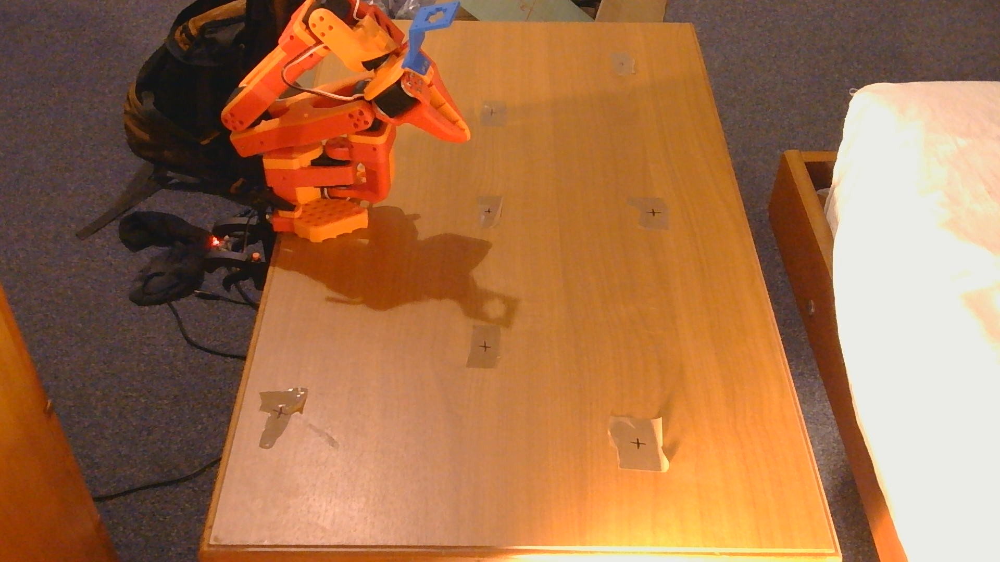

# pick_and_place_SO-101

A comparison of imitation learning and classical robotics for a pick-and-place task on the LeRobot
SO-101 arm: pick up a green box and drop it in a blue box.

This repo holds the **classical** side and results from imitation learning. A webcam finds both boxes, a homography maps camera pixels
to positions on the table, and inverse kinematics moves the arm. Nothing is learned.

> Project summary and the arm facts other projects need (calibration ID, joint correction, sag fix,
> environment): see [PROJECT_NOTES.md](PROJECT_NOTES.md).

## Results

| Classical | ACT (imitation learning) |
|---|---|
|  |  |

| | Classical | ACT (imitation learning) |
|---|---|---|
| Tries | 25 | 25 |
| Successes | **23 (92%)** | **12 (48%)** |
| Fails | 2 | 13 |

ACT succeeded 12 / 19 times with the green box to the right of the blue box and
0 / 6 with it on the left. Full breakdown and notes: [classical_imitation_comparison.md](classical_imitation_comparison.md).

## How it works

1. Create a homography, mapping pixels to table coordinates with robot base as origin. Find calibration offsets of the robot by finding set of offsets which minimizes error in homography (setup)
2. find the green box's bottom edges → its centre on the table   (box_footprint.py)
3. find the blue box's centre on the table                       (main.py)
4. IK (inverse kinematics): hover 7 cm above the green box, descend (also using IK), close the gripper
5. lift, move over the blue box, open the gripper
6. back to the rest pose; repeat

The bottom edges are needed for the green box instead of finding centroid on the contour, since the centroid of the bounding box as seen on the camera does not correspond to the center of the box in actual setup as the box is viewed at an angle. The bottom edges can be mapped faithfully to table coordinates using the homography, and using the known lengths of the box, the true center can be located.

## Running it

Requirements:

- Windows, with the `lerobot` conda env (LeRobot 0.5.2). Activate it first from an Anaconda Prompt
  with `conda activate lerobot`. Running its `python.exe` directly breaks NumPy.
- SO-101 follower on `COM5`, calibrated as `orange_follower_arm`. `move_to_joints.py` reads the
  calibration from the WSL folder named in `CALIB_DIR`.
- Webcam as camera 0, set up as in [Recreate the setup](#recreate-the-setup).
- The URDF `so101_new_calib.urdf`. It isn't in this repo; `main.py` and `test_homography.py` load it
  from `..\Robotics Control Project\SO101\`.

Then run:

```bash
python main.py
```

1. A preview window shows the green box's footprint (red outline) and the blue box's centre (cyan dot).
   Check that the cyan dot is on the blue box and not on the robot's own blue part.
2. Press **Enter** or **g** to pick and place, or **q** to quit.
3. After each run the arm goes back to its rest pose and holds it. Rearrange the boxes and go again.
4. When you quit, **hold the arm** before pressing Enter: the motors switch off and it goes limp.

Each step is limited to 10° per motor command (`max_relative_target=10` in `move_to_joints.py`).

Other scripts:

| Script | Use |
|---|---|
| `test_homography.py` | Click a spot in the camera view and the arm hovers over it. Good check after moving anything. |
| `measure_points.py` | Touch table marks with the arm to record where they are (forward kinematics). |
| `build_homography.py` | Rebuild `homography.json` from `table_points.csv`. |
| `get_marker_pixel_pos.py` | Click points on a camera frame to print their pixel coordinates. |

## Recreate the setup

Place the robot between the two tape markers on the table, and the camera between the two tape
markers on the ledge. Angle the camera so the edge of the table is in view, like this:



The camera angle matters more for the ACT policy than for the homography. The desk should be
about **47 cm** from the wall.

### Ruler measurements of the tape marks

The eight crosses on the table, measured with a ruler in the robot's base frame, and where each one
appeared in the camera image when the homography was built (16 Oct 2026). To check the camera
hasn't moved, run `get_marker_pixel_pos.py` and click the crosses: they should land within a few
pixels of these.

| Mark | x (cm) | y (cm) | Pixel (x, y) |
|---|---|---|---|
| 1 | 1.2 | −26.1 | (129, 352) |
| 2 | 22.6 | −21.6 | (360, 316) |
| 3 | 14.2 | −13.1 | (276, 253) |
| 4 | 17.5 | −0.9 | (306, 180) |
| 5 | 33.4 | −0.8 | (447, 179) |
| 6 | 12.8 | 14.6 | (269, 102) |
| 7 | 2.5 | 27.0 | (195, 48) |
| 8 | 26.0 | 21.6 | (357, 72) |

If the camera has moved, re-click the marks and rebuild the homography (see
[PROJECT_NOTES.md §3](PROJECT_NOTES.md#3-setup-specific-not-reusable-elsewhere)).
